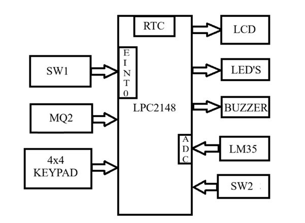
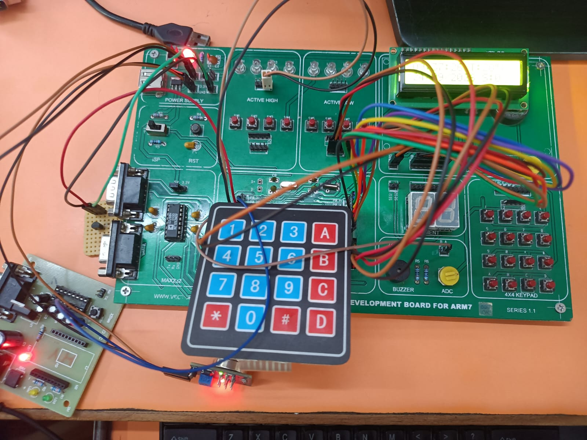
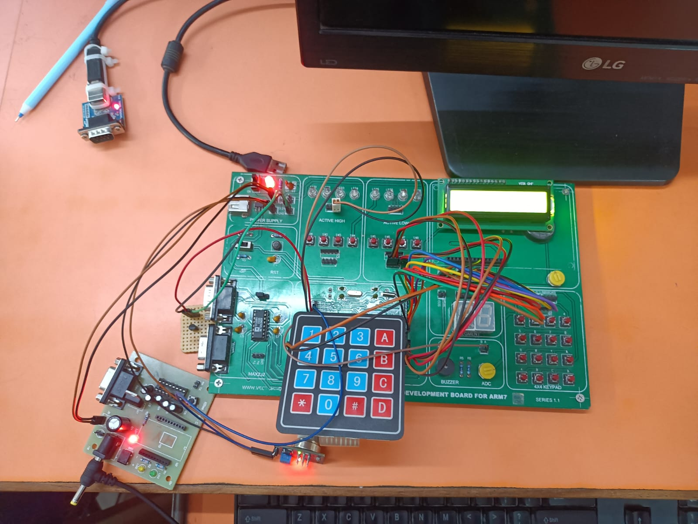

# Kitchen-Safety-Heat-and-Gas-Monitoring-System
## 1. Project Overview

The Kitchen Safety Heat and Gas Monitoring System is an embedded system developed using the LPC2148 ARM7 microcontroller.  
The primary objective of this project is to improve kitchen safety by continuously monitoring temperature and combustible gas levels.  
The system uses an LM35 temperature sensor to measure the surrounding temperature.  
An MQ-2 gas sensor is used to detect LPG and other combustible gases in the environment.  
The LPC2148 microcontroller processes the sensor readings and identifies potentially hazardous conditions.  
An LCD is interfaced with the microcontroller to display real-time temperature, gas status, and system information.  
An RTC (Real-Time Clock) module is used to maintain accurate date and time information.  
Whenever the temperature or gas concentration exceeds the predefined threshold, the system generates an alert through a buzzer.  
The system provides immediate warnings to help users identify dangerous situations and take necessary precautions.  
It also records abnormal safety events along with their corresponding RTC timestamps for future reference.  
A keypad-based interface is implemented to provide user interaction and system configuration options.  
Password protection is incorporated to restrict unauthorized access to important system settings.  
The system allows users to modify temperature and gas threshold values according to their requirements.  
Overall, this project provides a reliable and cost-effective embedded solution for monitoring kitchen safety and detecting potential fire and gas leakage hazards.

## 2. Objectives

* Monitor kitchen temperature using the LM35 sensor.
* Detect combustible gases and smoke using the MQ-2 sensor.
* Display temperature, sensor status, time, and date on a 16×2 LCD.
* Provide buzzer and LED alerts during unsafe conditions.
* Record safety events with RTC timestamps.
* Provide password-protected access to system settings.

## 3. Hardware Requirements

* LPC2148 ARM7 development board
* LM35 temperature sensor
* MQ-2 gas sensor module
* 16×2 LCD
* Real-Time Clock (RTC)
* 4×4 matrix keypad
* Switches
* LEDs
* Buzzer
* USB-UART converter or DB-9 cable

## 4. Block Diagram

## 5. Software Requirements

* Embedded C
* Keil µVision
* Flash Magic

## 6. Pin Configuration

The following assignments are based on the current project configuration and must be verified against the final source code and hardware wiring.

| Component      | LPC2148 Pin   | Function                         |
| -------------- | ------------- | -------------------------------- |
| LCD Data Bus   | P0.8–P0.15    | 8-bit data                       |
| LCD RS         | P0.16         | Register Select                  |
| LCD RW         | P0.17         | Read/Write control               |
| LCD EN         | P0.18         | Enable control                   |
| LM35 Output    | P0.27 / AD0.0 | Analog temperature input         |
| Switch 1       | P0.30 / EINT3 | External interrupt for edit mode |
| Switch 2       | P1.27         | Alert silencing switch           |
| Keypad Rows    | P1.16–P1.19   | Row connections                  |
| Keypad Columns | P1.20–P1.23   | Column connections               |

### Pins Requiring Verification

The MQ-2 analog input, buzzer, and LED connections must be documented after checking the source code and actual circuit diagram.

## 7. Working Principle

The LPC2148 reads the temperature and gas sensor signals and processes the readings. The LCD displays the sensor information along with the time and date provided by the RTC.

When the temperature exceeds the configured threshold or a hazardous gas condition is detected, the system is designed to activate an alert using the buzzer and LED indicators.

The project specification also includes safety event recording with timestamps and password-protected editing of settings.

## 8. Project Features

* Temperature monitoring
* Gas leakage detection
* LCD-based real-time display
* RTC time and date display
* Buzzer and LED alerts
* Safety event recording
* Password-protected edit mode
* Configurable temperature threshold

*Only mark features as implemented after verifying them on the actual hardware.*

## 9. Source Code

This repository contains the Embedded C source files and supporting project files used to develop the system.

## 10. Circuit Diagram and Documentation

Refer to the circuit diagram and supporting sensor datasheets included in this repository for hardware connection details and sensor specifications.

## 11. Testing and Results
## Result 

Test the project on the LPC2148 development board to verify:

* LM35 temperature readings
* MQ-2 sensor response
* LCD display operation
* RTC time and date
* Buzzer and LED alerts
* Switch and keypad operation
* Password validation and event recording, if implemented

Add actual hardware photographs and test results after testing.

## 12. Applications

* Kitchen safety monitoring
* Gas leakage alert systems
* Temperature monitoring
* Embedded safety and alarm applications

## 13. Author

**Burra Nagaraju**

**Project:** Kitchen Safety Heat and Gas Monitoring System
**Microcontroller:** LPC2148 ARM7
**Programming Language:** Embedded C

